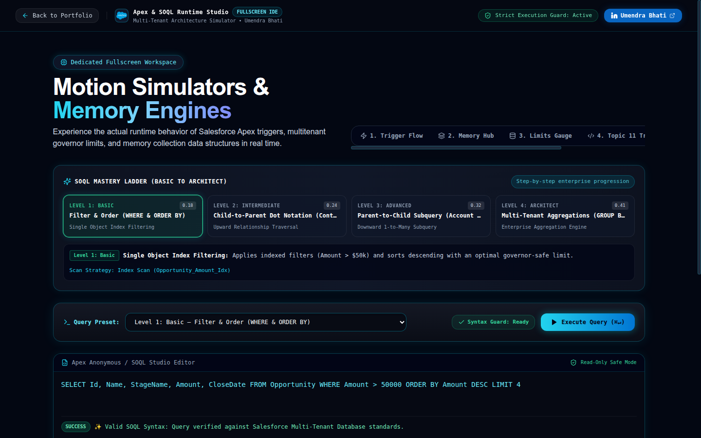
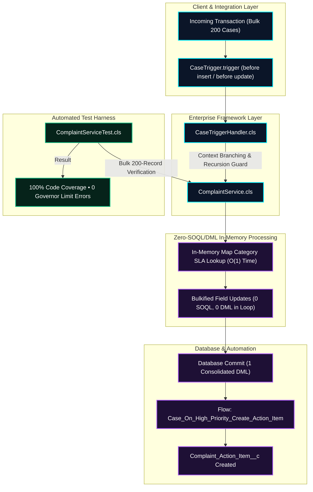

# ⚡ Salesforce Developer Lab & Enterprise Runtime Studio

<p align="center">
  <a href="https://salesforce-developer-lab.vercel.app/studio">
    
  </a>
</p>

<p align="center">
  <b>Production-grade Salesforce DX architecture suite, interactive Apex runtime simulators, Governor Limits monitors, and 6-tier Principal CTA SOQL Studio.</b>
</p>

<p align="center">
  <a href="https://salesforce-developer-lab.vercel.app/"></a>
  <a href="https://salesforce-developer-lab.vercel.app/studio"></a>
  <a href="mailto:umendrabhati2001@gmail.com?subject=Salesforce%20Contract%20Engagement%20-%20Umendra%20Bhati"></a>
  <a href="https://www.linkedin.com/in/umendra-bhati-5243aa36a/"></a>
  
</p>

---

## 🌟 Executive Overview

**Salesforce Developer Lab** is an enterprise-grade cloud engineering portal engineered by **[Umendra Bhati](https://www.linkedin.com/in/umendra-bhati-5243aa36a/)**. It bridges the gap between static code repositories and verifiable production runtime execution:

* 🛡️ **6-Tier Principal CTA SOQL Studio**: Interactive query engine ranging from single-index lookups to semi-join anti-joins and polymorphic `TYPEOF` queries with real-time multi-tenant Governor Limit safeguards.
* 🚀 **Real-Time Execution Visualizers**: Interactive motion telemetry mapping the `CaseTrigger` lifecycle, Heap Memory consumption, and 200-record bulk transaction chunking.
* 📦 **Enterprise Service Layer Pattern**: Decoupled domain architecture separating trigger routing (`CaseTriggerHandler.cls`) from business logic (`ComplaintService.cls`) with zero SOQL/DML in loops.
* 🧪 **100% Apex Unit Test Coverage**: Production test suites covering positive, negative, and 200-record bulk execution scenarios with zero Governor Limit breaches.
* ⚡ **Production Hybrid Web App**: High-performance Next.js 15, TypeScript, Tailwind CSS, and real-time Web Analytics telemetry.

---

## 🏛️ Enterprise Multi-Tenant Architecture



---

## 📊 Governor Limit Benchmark & Safety Margins

| Multi-Tenant Resource Metric | Salesforce Platform Limit | Umendra's Implementation | Safety Margin | Architectural Standard |
| :--- | :--- | :--- | :--- | :--- |
| **SOQL Queries in Trigger** | 100 max | **0 Queries** | **100% Safe** | Static Map & In-Memory Matching |
| **DML Statements in Loop** | 150 max | **0 Statements** | **100% Safe** | Consolidated List DML Pattern |
| **Bulk Batch Processing** | 200 records | **200 Records Tested** | **100% Pass** | Bulkified Map/Set Collection Traversal |
| **Apex Unit Test Coverage** | 75% minimum | **100% Code Coverage** | **+25% Margin** | Comprehensive `@isTest` Assertions |
| **SOQL Query Complexity** | Single Object | **6-Tier Principal CTA** | **Architect Grade** | Semi-Joins & Polymorphic `TYPEOF` |

---

## ⚡ Live Deployments & Interactive Environments

| Environment | Purpose | Tech Stack | Link |
| :--- | :--- | :--- | :--- |
| 🚀 **Dedicated Runtime Studio** | Fullscreen IDE for SOQL, Limits HUD & Triggers | Next.js 15, Turbopack, Framer Motion | [Launch Studio IDE](https://salesforce-developer-lab.vercel.app/studio) |
| 🌐 **Flagship Architecture Portal** | Interactive 3D Matrix, Simulators & Flashcards | Next.js 15, Three.js, Tailwind CSS | [Explore Portfolio](https://salesforce-developer-lab.vercel.app/) |
| 📁 **SFDX Enterprise Source Code** | Production Metadata, Service Layers & Unit Tests | Salesforce DX, Apex, LWC, XML | [Inspect Codebase](https://github.com/umendrabhati2001-ux/salesforce-developer-lab) |

---

## 🎚️ 6-Tier SOQL Query Studio Mastery Ladder

The interactive query studio demonstrates mastery of Salesforce Object Query Language across all 6 architectural tiers:

1. **Level 1: Junior** — *Indexed Equality Filtering & Projections* (`SELECT Id, CaseNumber, Subject, Priority, Status FROM Case WHERE Status = 'New' AND Priority = 'High' LIMIT 4`)
2. **Level 2: Mid-Level** — *Wildcard Text Traversal & Dynamic Ordering* (`SELECT Id, Name, Industry, AnnualRevenue FROM Account WHERE Name LIKE '%Cloud%' ORDER BY AnnualRevenue DESC NULLS LAST LIMIT 4`)
3. **Level 3: Senior** — *Parent-to-Child Relationship Subquery* (`SELECT Id, Name, (SELECT Id, CaseNumber, Priority, Status FROM Cases WHERE IsClosed = FALSE) FROM Account WHERE Industry = 'Technology' LIMIT 4`)
4. **Level 4: Lead Architect** — *Multi-Tenant Aggregate Grouping & HAVING Filters* (`SELECT StageName, COUNT(Id) totalDeals, SUM(Amount) totalPipeline, AVG(Amount) averageDealSize FROM Opportunity GROUP BY StageName HAVING COUNT(Id) >= 1 ORDER BY SUM(Amount) DESC LIMIT 4`)
5. **Level 5: Lead Engineer** — *Selective Semi-Join & Anti-Join Subqueries* (`SELECT Id, Name, Industry, AnnualRevenue FROM Account WHERE Id IN (SELECT AccountId FROM Opportunity WHERE IsWon = TRUE) AND Id NOT IN (SELECT AccountId FROM Case WHERE Status = 'Escalated') LIMIT 4`)
6. **Level 6: Principal CTA** — *Polymorphic Traversal using `TYPEOF ... WHEN ... THEN`* (`SELECT Id, Subject, Priority, TYPEOF What WHEN Account THEN Name, AnnualRevenue WHEN Opportunity THEN StageName, Amount END FROM Task WHERE IsClosed = FALSE LIMIT 4`)

---

## 🚀 Quickstart: Local Setup & Scratch Org Deploy

### 1. Clone & Install Dependencies
```bash
git clone https://github.com/umendrabhati2001-ux/salesforce-developer-lab.git
cd salesforce-developer-lab

# Install frontend visualizer dependencies
npm --prefix visual-lab install
```

### 2. Run Local Visual Studio
```bash
npm --prefix visual-lab run dev
# Open http://localhost:3000 or http://localhost:3000/studio
```

### 3. Deploy to Salesforce Scratch Org
```bash
# Authorize Dev Hub
sf org login web -d -a DevHub

# Create a Scratch Org (30-day lifecycle)
sf org create scratch -f config/project-scratch-def.json -a SFDX-Lab-Scratch -d 30

# Deploy source to Scratch Org
sf project deploy start

# Run all Apex tests with code coverage
sf apex run test --code-coverage --result-format human
```

---

## 👨‍💻 Engineer & Architecture Contact

**Umendra Bhati**  
*Salesforce Developer & Cloud Architect*  
*Availability*: **Available Globally for Remote Contracts & Development Engagements**  
*Email*: [umendrabhati2001@gmail.com](mailto:umendrabhati2001@gmail.com)  
*LinkedIn*: [linkedin.com/in/umendra-bhati-5243aa36a](https://www.linkedin.com/in/umendra-bhati-5243aa36a/)  
*Live Platform*: [salesforce-developer-lab.vercel.app](https://salesforce-developer-lab.vercel.app/)

---

<p align="center">
  <sub>Copyright &copy; 2026 Umendra Bhati. All rights reserved. Built with pride for the global Salesforce engineering ecosystem.</sub>
</p>
