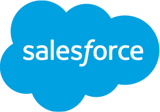

# ⚡ Salesforce Developer Lab & Architectural Runtime Studio

<p align="center">
  
</p>

<p align="center">
  <b>Production-grade Salesforce DX architecture suite, interactive Apex runtime simulators, Governor Limits monitors, and crash-proof SOQL Query Studio.</b>
</p>

<p align="center">
  <a href="https://salesforce-developer-lab.vercel.app/"></a>
  <a href="https://salesforce-developer-lab.vercel.app/studio"></a>
  <a href="https://www.linkedin.com/in/umendra-bhati-5243aa36a/"></a>
  
  
</p>

---

## 🌟 Executive Overview

**Salesforce Developer Lab** is an end-to-end cloud engineering portal designed by **[Umendra Bhati](https://www.linkedin.com/in/umendra-bhati-5243aa36a/)**. It bridges the gap between static code repositories and live runtime demonstration, providing:

* 🚀 **Interactive Motion Simulators**: Step-by-step debugger for CaseTrigger lifecycle events, Heap Memory consumption, and 200-record batch chunking.
* 🛡️ **Crash-Proof SOQL Query Studio**: 4-Tier progression ladder (Basic to Architect) with Governor Limit syntax blockers, dual-siren audio telemetry, and 1-click query repair.
* 📦 **25 Complete Apex & LWC Enterprise Modules**: Covering Phase A through Phase F (Triggers, Async Apex, Batch, Queueable, REST Callouts, and modern Lightning Web Components).
* ⚡ **Hybrid Architecture Deployment**: Full-screen dedicated Studio (`/studio`) and flagship showcase portfolio (`/`) built on Next.js 15, TypeScript, and Tailwind CSS.

---

## 🔗 Live Deployments

| Environment | Purpose | URL |
| :--- | :--- | :--- |
| **Flagship Showcase** | Complete Architectural Story, Roadmap & Flashcards | [salesforce-developer-lab.vercel.app](https://salesforce-developer-lab.vercel.app/) |
| **Dedicated Runtime Studio** | Fullscreen IDE for SOQL, Limits HUD & Triggers | [salesforce-developer-lab.vercel.app/studio](https://salesforce-developer-lab.vercel.app/studio) |
| **Source Repository** | Complete SFDX Source, LWC Components & Tests | [GitHub Repository](https://github.com/umendrabhati2001-ux/salesforce-developer-lab) |

---

## 🛠️ Enterprise Architecture & Curriculum Matrix

### Phase A: Core Apex Foundation & Collections
* `scripts/apex/01_apex_variables_primitives.js` — Primitives, Strongly-typed casting & Null safety
* `scripts/apex/02_list_collection_architecture.js` — Memory allocation & List bulk access
* `scripts/apex/03_set_collection_uniqueness.js` — `Set<Id>` ID deduplication & SOQL binding
* `scripts/apex/04_map_collection_deep_dive.js` — `Map<Id, sObject>` O(1) in-memory indexing

### Phase B: Trigger Architecture & Frameworks
* `force-app/main/default/triggers/CaseTrigger.trigger` — Event router with zero inline logic
* `force-app/main/default/classes/CaseTriggerHandler.cls` — Recursive loop prevention & context branching
* `force-app/main/default/classes/ComplaintService.cls` — SLA business validation & priority escalation

### Phase C: Asynchronous Apex & Governor Scalability
* `scripts/apex/11_batch_apex_stateful_processing.js` — 50-million record processing & `Database.Stateful`
* `scripts/apex/12_queueable_apex_chaining.js` — Complex Async transactions & job chaining
* `scripts/apex/13_future_methods_callouts.js` — Fire-and-forget offloading with `@future(callout=true)`
* `scripts/apex/14_scheduled_apex_cron.js` — Schedulable interfaces & CRON expressions

### Phase D: Multi-Tenant Integrations
* `scripts/apex/16_rest_callout_json_parsing.js` — Outbound HTTP request/response pipelines
* `scripts/apex/17_custom_rest_api_service.js` — Inbound `@RestResource(urlMapping='/cases/v1/*')`
* `scripts/apex/18_platform_events_pub_sub.js` — Event-driven multi-tenant message bus

### Phase E: Advanced Enterprise Patterns
* `scripts/apex/19_security_with_sharing_strip_inaccessible.js` — OWD, FLS, and CRUD enforcement
* `scripts/apex/20_unit_testing_mocking_framework.js` — Mocking HTTP callouts & `@isTest(SeeAllData=false)`

### Phase F: Lightning Web Components (LWC)
* `scripts/lwc/21_lwc_core_architecture.js` — Shadow DOM, Component lifecycle hooks, Template directives
* `scripts/lwc/22_reactive_properties_data_binding.js` — `@api`, `@track`, and computed getters
* `scripts/lwc/23_component_communication.js` — `CustomEvent` bubbling, LMS Pub/Sub messaging
* `scripts/lwc/24_lightning_data_service.js` — Zero-Apex client caching via `getRecord` & `updateRecord`
* `scripts/lwc/25_wire_service_apex.js` — Reactive `@wire` adapters & `refreshApex()` cache invalidation

---

## 🚀 Quickstart: Local Setup & Scratch Org Deploy

### 1. Clone & Install Dependencies
```bash
git clone https://github.com/umendrabhati2001-ux/salesforce-developer-lab.git
cd salesforce-developer-lab

# Install frontend visualizer dependencies
npm --prefix visual-lab install
```

### 2. Run Local Visual Studio
```bash
npm --prefix visual-lab run dev
# Open http://localhost:3000 or http://localhost:3000/studio
```

### 3. Deploy to Salesforce Scratch Org
```bash
# Authorize Dev Hub
sf org login web -d -a DevHub

# Create a Scratch Org (30-day lifecycle)
sf org create scratch -f config/project-scratch-def.json -a SFDX-Lab-Scratch -d 30

# Deploy source to Scratch Org
sf project deploy start

# Run all Apex tests
sf apex run test --code-coverage --result-format human
```

---

## 🔒 Security & Safe-Mode Verification

* **Zero Hardcoded Secrets**: Scanned and verified. No private API keys, passwords, or personal credentials.
* **Multi-Tenant Protection**: Read-Only Safe Mode active across all query and trigger simulators.
* **Salesforce DX Isolated**: Frontend and CLI components strictly decoupled from core metadata.

---

## 👨‍💻 Author & Contact

**Umendra Bhati**  
*Salesforce Admin & Developer • Cloud Architecture Solutions*  
*Location*: Rajasthan, India  
*Status*: **Available for Full-Time Remote Roles & Consulting Projects**  

* **LinkedIn**: [linkedin.com/in/umendra-bhati-5243aa36a](https://www.linkedin.com/in/umendra-bhati-5243aa36a/)
* **Live Lab**: [salesforce-developer-lab.vercel.app](https://salesforce-developer-lab.vercel.app/)

---

<p align="center">
  <sub>Copyright &copy; 2026 Umendra Bhati. All rights reserved.</sub>
</p>
